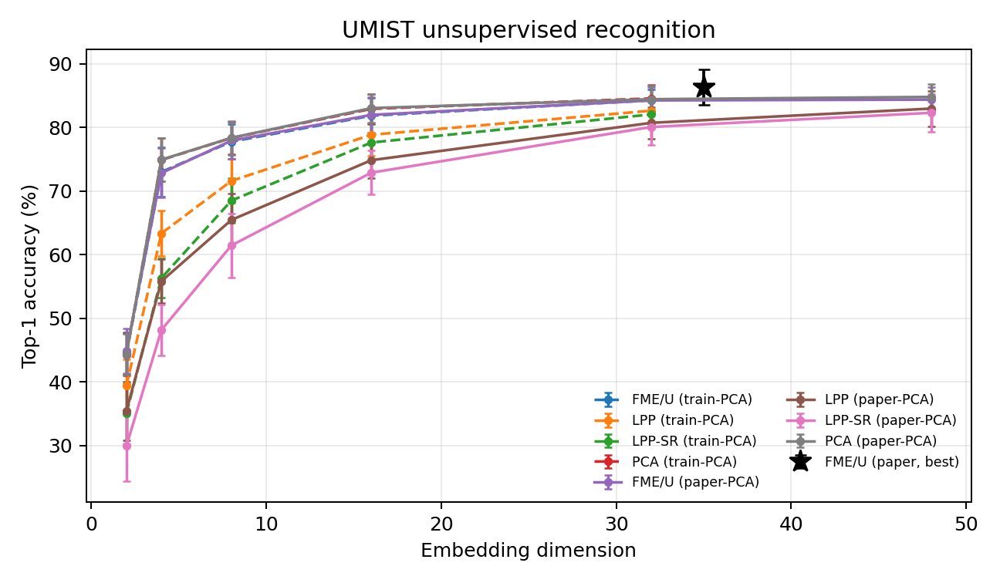
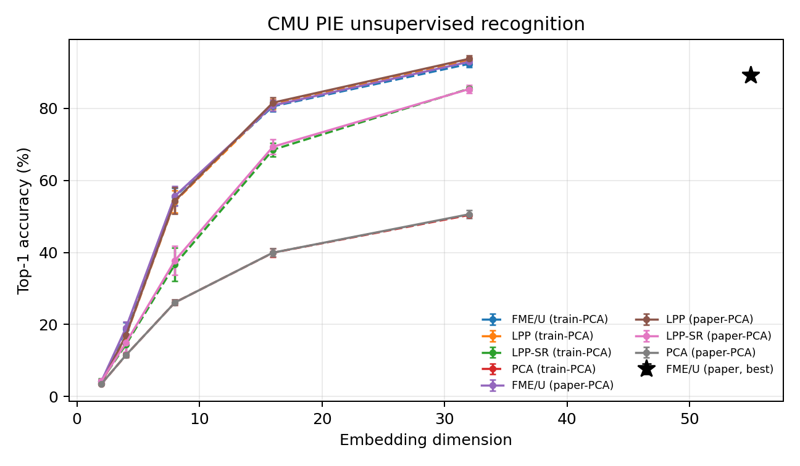
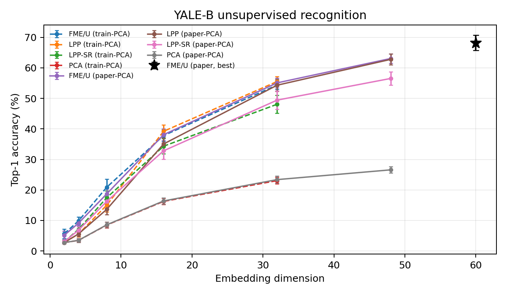
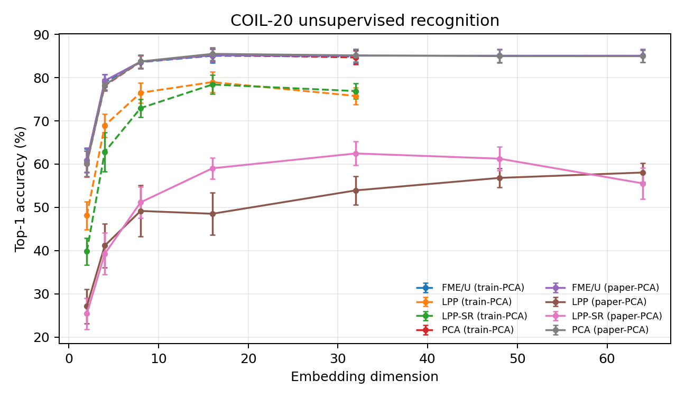

# Flexible Manifold Embedding — Reproduction

A NumPy/SciPy reproduction of the semi-supervised **FME** and unsupervised **FME/U** algorithms of
Nie, Xu, Tsang, and Zhang, *Flexible Manifold Embedding: A Framework for Semi-Supervised and
Unsupervised Dimension Reduction*, IEEE Transactions on Image Processing **19**(7), 1921–1932
(2010). [DOI](https://doi.org/10.1109/TIP.2010.2044958).

The repository contains the implementation, the benchmark preparation scripts, the actual runs
(20 random splits per setting), the numerical tables, and the accuracy-versus-dimension figures.
The main comparison follows the paper's 50% train / 50% test split, 95% PCA preprocessing,
and best-of-grid reporting, with documented approximations to the graph and parameter grid. A leakage-free variant that fits PCA on the training split only
is also reported. The results are mixed: the FME/FME/U ranking is reproduced on UMIST, COIL-20, and 20-NEWS, and FME/U is close to
the published value on Yale-B, but the semi-supervised
Yale-B experiment is substantially below the paper and is not reproduced. The discrepancies are
documented rather than tuned away.

## Structure

```text
fme/
  model.py                    FME and FME/U solvers; out-of-sample mappings
  graph.py                    symmetric nearest-neighbor Gaussian graph
  baselines.py                LGC, GFHF, LapRLS/L, LPP, LPP-SR
  data.py                     data loading, splits, train-only or paper-style PCA
run_experiments.py            split evaluation, parameter sweeps, resume, summaries
scripts/
  prepare_benchmarks.py       convert local .mat / 20news files to data/*.npz
  prepare_images.py           class-folder image conversion
  prepare_20news.py           approximate 20NEWS downloader
  build_report.py             collect runs, emit tables and figures
  plot_results.py             single-run accuracy-vs-dimension plot
  merge_runs.py               combine disjoint split ranges
results/                      committed summaries, tables, and figures
tests/                        numerical and protocol regression tests
data/                         generated at runtime; not tracked
outputs/                      generated at runtime; not tracked
```

## Installation

Python 3.10 or newer:

```bash
python -m venv .venv
source .venv/bin/activate
pip install -r requirements.txt
python -m pytest -q
```

The algorithms use dense/sparse numerical linear algebra and run on CPU. No GPU is used. The
committed runs used Python 3.11.7, NumPy 1.26.4, SciPy 1.11.4, scikit-learn 1.2.2, pandas 2.1.4,
and matplotlib 3.8.x on 4 CPU cores.

## Mathematical model

Let `X` have shape `(n_samples, n_features)`; `F` is the label-score matrix, `Y` is the class
indicator matrix for labeled observations, `U` is the diagonal label indicator, `L` is the graph
Laplacian, and `h(X) = XW + 1 b^T`.

For semi-supervised learning the implementation minimizes

\[
\operatorname{tr}[(F-Y)^T U(F-Y)] + \operatorname{tr}(F^T L F)
+ \mu\left(\|W\|_F^2+\gamma\|F-XW-\mathbf{1}b^T\|_F^2\right).
\]

Eliminating the ridge variables gives

\[
H=I-\tfrac{11^T}{n},\quad
P=H-\gamma HX (I+\gamma X^THX)^{-1} X^T H,\quad
(U+L+\mu\gamma P)F=UY.
\]

`FlexibleManifoldEmbedding.scores_` is the optimized transductive `F`; the inductive embedding is
`transform(X) = XW + b`. For FME/U the method minimizes
`tr[F^T(L+mu*gamma*P)F]` with centered, unit-orthogonal columns and then regresses `F` onto `X`.

### Numerical solver

For `n > dense_threshold` and `d <= n`, the code eliminates `F` and solves the equivalent
`d`-dimensional system for `W` after applying
`B^{-1}` with `B = U + L + mu*gamma*H`. The sparse bordered solve avoids the
cancellation-prone Sherman-Morrison update at extreme `mu*gamma`; the dense direct solve is kept
as a test oracle. For `d > n` a conjugate-gradient path with a Jacobi retry is retained. The
solver was checked against the reference FME formulas and against the dense solution; the maximum
coefficient difference at `mu*gamma = 10^12` is below `1e-7`.

## Paper protocol and local configuration

The manuscript specifies:

| Item | Paper |
|---|---|
| Semi-supervised split | 50% training / 50% testing; `p` labeled samples per class from the training half |
| Labeled samples | UMIST, CMU PIE, Yale-B, COIL-20: `p = 1,2,3`; 20-NEWS: `p = 10,20,30` |
| Unsupervised split | 5 training images per class; remaining images for testing |
| PCA | 95% retained energy, used in all experiments |
| Graph | Gaussian kNN graph, `k = 10`, bandwidth selected as in reference [17] |
| Parameter grid | each parameter in `{10^-9, 10^-6, 10^-3, 10^0, 10^3, 10^6, 10^9}` |
| Reporting | best parameter configuration, mean ± standard deviation over 20 random splits |
| Classification | nearest neighbor after dimension reduction; FME unlabeled nodes use `argmax F`; unseen samples use `argmax h(X)`; LGC/GFHF have no unseen-sample prediction |

The local runs in `results/` use the following fixed configuration:

- `k = 5` and the median nonzero squared neighbor distance as the Gaussian bandwidth.
- `mu, gamma in {1e-6, 1e-3, 1, 1e3, 1e6}` (25 settings).
- `--selection paper_oracle`: for each split, method, and phase, report the best observed outer
  accuracy over the grid. This approximates the paper's best-of-grid reporting but is
  **optimistic and not leakage-free**; the evaluation labels are used for selection.
- **Primary results** fit PCA on the training split only (no test-feature leakage). This gives
  FME/U at most about 33/40/48 dimensions on PIE/Yale-B/UMIST and therefore cannot reach the
  paper's 55/60/35-dimensional optima on PIE and Yale-B.
- **Paper-style PCA variant** fits PCA on training+test features. It is transductive, but it
  matches the dimensionality range implied by Table II and is the fair numerical comparison for
  the unsupervised table. It is explicitly labelled `paper-PCA` everywhere.

These graph and grid settings are approximations, not a verified transcription of the authors'
code. The paper's graph bandwidth rule could not be recovered exactly; a diagnostic with `k=10`
and the five reference bandwidth values did not materially change the conclusions (see the
Yale-B discussion).

### Evaluation correction

The original runner classified FME by 1-NN on the projected coordinates. The reference FME
implementation used by the authors' follow-up work uses `argmax F` for unlabeled training nodes
and `argmax h(X)` for unseen samples. The runner now uses that protocol for FME and LapRLS/L;
LGC/GFHF use their own transductive scores. The unsupervised experiments still use 1-NN in the
learned embedding, as in the paper.

## Datasets and preprocessing

The files are generated with `scripts/prepare_benchmarks.py`; datasets are not committed.

| Dataset | Source used here | Samples × features | Preprocessing | Fidelity |
|---|---|---:|---|---|
| UMIST | public `umist_cropped.mat` mirror | 575 × 644 | 20 subjects; 112×92 resized to 28×23 grayscale (bilinear) | close to paper (575 images, 28×23) |
| CMU PIE | `CMUPIEData.mat` | 2856 × 1024 | 68 subjects × 42 C27 images; 32×32 grayscale | **approximate**: paper has ~49 images/subject |
| Yale-B | `YaleB_32x32.mat` | 2414 × 1024 | 38 subjects × 59–64 images; 32×32 grayscale | image release/cropping may differ from the paper's |
| COIL-20 | Deng Cai `COIL20.mat` | 1440 × 1024 | 20 objects × 72 images; 32×32 grayscale | close to paper |
| 20-NEWS | original `20news-18828.tar.gz` | 3977 × 8014 | four `rec.*` categories; scikit-learn TF-IDF, `max_features=8014`, L2 norm | **approximate**: paper reports 3970 documents and its own TF-IDF pipeline |

The CMU PIE and 20-NEWS substitutions are the main dataset-level differences. The Yale-B images
used here are also substantially harder for a raw 1-NN classifier than the paper's reported
numbers suggest; see below.

## Reproduction commands

Prepare the arrays from the local raw files:

```bash
python scripts/prepare_benchmarks.py \
  --raw-dir /path/to/raw \
  --output-dir data \
  --news-archive /path/to/20news-18828.tar.gz
```

Run the tests and smoke checks:

```bash
python -m pytest -q
python run_experiments.py --dataset digits --max-samples 180 --mode semi \
  --splits 1 --per-class 1 --mu 0.1 --gamma 1 --output outputs/digits-check
```

Run one dataset (the committed runs used `--selection paper_oracle`):

```bash
python run_experiments.py --dataset umist --mode semi --splits 20 \
  --per-class 1,2,3 --mu 1e-6,1e-3,1,1e3,1e6 --gamma 1e-6,1e-3,1,1e3,1e6 \
  --selection paper_oracle --output outputs/umist_semi --threads 1
python run_experiments.py --dataset umist --mode unsup --splits 20 \
  --dims 2,4,8,16,32 --mu 1e-6,1e-3,1,1e3,1e6 --gamma 1e-6,1e-3,1,1e3,1e6 \
  --selection paper_oracle --output outputs/umist_unsup --threads 1
```

Add `--pca-all` for the paper-style transductive PCA variant. The 20-NEWS runs used four
non-overlapping workers and were merged:

```bash
for w in 0 1 2 3; do
  python run_experiments.py --dataset 20news --mode semi --splits 5 \
    --split-start $((w*5)) --per-class 10,20,30 \
    --mu 1e-6,1e-3,1,1e3,1e6 --gamma 1e-6,1e-3,1,1e3,1e6 \
    --selection paper_oracle --output outputs/news_w$w --threads 1 &
done
wait
python scripts/merge_runs.py outputs/news_w0 outputs/news_w1 \
  outputs/news_w2 outputs/news_w3 --output outputs/20news_semi
```

Rebuild all committed tables and figures from the run directories:

```bash
python scripts/build_report.py --outputs outputs
```

## Reproduction Results

All entries are mean ± sample standard deviation over 20 random splits unless the row says
otherwise. `N/A` means the quantity is not defined for that method (LGC/GFHF have no
out-of-sample test prediction) or was not evaluated.

### Table A — Semi-supervised FME

`train-PCA` is the leakage-free primary variant; `paper-PCA` is the paper-style transductive PCA
variant. `Paper` values are transcribed from Table I of the paper. Δ is our paper-PCA value minus
the paper value, in percentage points. The 20-NEWS paper-PCA variant was not run; its train-only
primary result is reported instead.

| Dataset   |   Labels/class | Unlab (train-PCA)   | Test (train-PCA)   | Unlab (paper-PCA)   | Test (paper-PCA)   | Paper unlab   | Paper test   | Δ unlab   | Δ test   |
|:----------|---------------:|:--------------------|:-------------------|:--------------------|:-------------------|:--------------|:-------------|:----------|:---------|
| UMIST     |              1 | 64.96 ± 3.98        | 62.86 ± 3.37       | 65.22 ± 4.22        | 63.54 ± 3.27       | 63.50 ± 5.50  | 63.10 ± 5.40 | +1.72     | +0.44    |
| UMIST     |              2 | 74.05 ± 4.22        | 72.34 ± 4.08       | 73.97 ± 4.02        | 72.69 ± 4.37       | 79.70 ± 4.50  | 79.10 ± 4.20 | -5.73     | -6.41    |
| UMIST     |              3 | 80.75 ± 4.15        | 77.99 ± 3.17       | 80.59 ± 4.42        | 79.06 ± 2.76       | 86.90 ± 3.20  | 86.10 ± 3.10 | -6.31     | -7.04    |
| CMU PIE   |              1 | 56.24 ± 3.27        | 55.48 ± 3.03       | 56.64 ± 3.40        | 56.94 ± 3.21       | 63.20 ± 2.80  | 62.70 ± 2.60 | -6.56     | -5.76    |
| CMU PIE   |              2 | 70.12 ± 2.59        | 69.14 ± 2.99       | 70.57 ± 2.68        | 70.74 ± 2.76       | 81.80 ± 2.00  | 81.50 ± 1.90 | -11.23    | -10.76   |
| CMU PIE   |              3 | 80.54 ± 2.68        | 79.85 ± 2.04       | 81.42 ± 2.72        | 81.58 ± 1.94       | 89.10 ± 1.20  | 88.90 ± 1.00 | -7.68     | -7.32    |
| YALE-B    |              1 | 24.97 ± 2.86        | 24.65 ± 3.10       | 25.32 ± 2.82        | 25.43 ± 3.14       | 53.90 ± 3.30  | 54.20 ± 2.90 | -28.58    | -28.77   |
| YALE-B    |              2 | 31.52 ± 3.40        | 31.06 ± 3.10       | 32.14 ± 3.44        | 32.56 ± 2.87       | 75.10 ± 2.60  | 75.00 ± 2.70 | -42.96    | -42.44   |
| YALE-B    |              3 | 38.23 ± 2.96        | 37.51 ± 2.43       | 38.67 ± 3.15        | 39.32 ± 2.51       | 85.90 ± 2.10  | 85.60 ± 2.00 | -47.23    | -46.28   |
| COIL-20   |              1 | 81.13 ± 2.76        | 77.64 ± 2.94       | 81.13 ± 2.94        | 78.22 ± 3.11       | 75.10 ± 3.20  | 75.50 ± 3.10 | +6.03     | +2.72    |
| COIL-20   |              2 | 84.56 ± 1.67        | 81.11 ± 2.23       | 84.53 ± 1.65        | 81.43 ± 2.23       | 82.20 ± 2.90  | 81.90 ± 3.10 | +2.33     | -0.47    |
| COIL-20   |              3 | 87.02 ± 1.66        | 82.97 ± 1.79       | 86.94 ± 1.60        | 83.35 ± 1.70       | 86.10 ± 2.30  | 85.60 ± 2.60 | +0.84     | -2.25    |
| 20-NEWS   |             10 | 78.82 ± 6.95        | 76.45 ± 6.89       | N/A                 | N/A                | 83.20 ± 3.20  | 82.50 ± 3.60 | N/A       | N/A      |
| 20-NEWS   |             20 | 86.32 ± 2.92        | 85.10 ± 2.44       | N/A                 | N/A                | 88.20 ± 1.90  | 87.60 ± 2.00 | N/A       | N/A      |
| 20-NEWS   |             30 | 89.68 ± 1.35        | 89.47 ± 1.25       | N/A                 | N/A                | 90.10 ± 1.30  | 89.60 ± 1.50 | N/A       | N/A      |

### Table A — Locally reproduced baselines

Rows at 3 labeled samples/class (30 for 20-NEWS). The full grid, including all label regimes and
the paper-only methods MFA/TCA/SDA, is in [`results/tables.md`](results/tables.md).

| Dataset   |   Labels/class | Method   | Unlab (train-PCA)   | Test (train-PCA)   | Unlab (paper-PCA)   | Test (paper-PCA)   | Paper unlab   | Paper test   | Δ unlab   | Δ test   |
|:----------|---------------:|:---------|:--------------------|:-------------------|:--------------------|:-------------------|:--------------|:-------------|:----------|:---------|
| UMIST     |              3 | FME      | 80.75 ± 4.15        | 77.99 ± 3.17       | 80.59 ± 4.42        | 79.06 ± 2.76       | 86.90 ± 3.20  | 86.10 ± 3.10 | -6.31     | -7.04    |
| UMIST     |              3 | LapRLS/L | 79.21 ± 4.24        | 77.76 ± 3.31       | 79.19 ± 4.32        | 78.51 ± 3.03       | 82.10 ± 3.90  | 81.70 ± 3.80 | -2.91     | -3.19    |
| UMIST     |              3 | LGC      | 73.48 ± 5.61        | N/A                | 73.57 ± 5.23        | N/A                | 83.80 ± 3.90  | N/A          | -10.23    | N/A      |
| UMIST     |              3 | GFHF     | 80.00 ± 4.20        | N/A                | 80.07 ± 4.08        | N/A                | 85.80 ± 3.50  | N/A          | -5.73     | N/A      |
| CMU PIE   |              3 | FME      | 80.54 ± 2.68        | 79.85 ± 2.04       | 81.42 ± 2.72        | 81.58 ± 1.94       | 89.10 ± 1.20  | 88.90 ± 1.00 | -7.68     | -7.32    |
| CMU PIE   |              3 | LapRLS/L | 80.54 ± 2.68        | 79.84 ± 2.04       | 81.42 ± 2.72        | 81.57 ± 1.94       | 87.80 ± 1.10  | 87.70 ± 1.10 | -6.38     | -6.13    |
| CMU PIE   |              3 | LGC      | 42.89 ± 2.20        | N/A                | 42.95 ± 2.07        | N/A                | 55.90 ± 1.90  | N/A          | -12.95    | N/A      |
| CMU PIE   |              3 | GFHF     | 45.36 ± 2.14        | N/A                | 45.46 ± 2.04        | N/A                | 55.80 ± 2.10  | N/A          | -10.34    | N/A      |
| YALE-B    |              3 | FME      | 38.23 ± 2.96        | 37.51 ± 2.43       | 38.67 ± 3.15        | 39.32 ± 2.51       | 85.90 ± 2.10  | 85.60 ± 2.00 | -47.23    | -46.28   |
| YALE-B    |              3 | LapRLS/L | 38.23 ± 2.96        | 37.50 ± 2.44       | 38.67 ± 3.15        | 39.30 ± 2.52       | 84.20 ± 2.60  | 83.80 ± 2.50 | -45.53    | -44.50   |
| YALE-B    |              3 | LGC      | 22.06 ± 2.21        | N/A                | 21.95 ± 2.22        | N/A                | 49.60 ± 3.50  | N/A          | -27.65    | N/A      |
| YALE-B    |              3 | GFHF     | 23.95 ± 2.26        | N/A                | 23.92 ± 2.31        | N/A                | 45.20 ± 3.90  | N/A          | -21.28    | N/A      |
| COIL-20   |              3 | FME      | 87.02 ± 1.66        | 82.97 ± 1.79       | 86.94 ± 1.60        | 83.35 ± 1.70       | 86.10 ± 2.30  | 85.60 ± 2.60 | +0.84     | -2.25    |
| COIL-20   |              3 | LapRLS/L | 78.45 ± 2.44        | 78.38 ± 2.10       | 78.73 ± 2.25        | 78.65 ± 2.07       | 78.60 ± 2.60  | 78.80 ± 2.50 | +0.13     | -0.15    |
| COIL-20   |              3 | LGC      | 87.11 ± 1.77        | N/A                | 87.03 ± 1.73        | N/A                | 85.90 ± 2.10  | N/A          | +1.13     | N/A      |
| COIL-20   |              3 | GFHF     | 87.14 ± 1.86        | N/A                | 87.08 ± 1.79        | N/A                | 85.60 ± 2.00  | N/A          | +1.48     | N/A      |
| 20-NEWS   |             30 | FME      | 89.68 ± 1.35        | 89.47 ± 1.25       | N/A                 | N/A                | 90.10 ± 1.30  | 89.60 ± 1.50 | N/A       | N/A      |
| 20-NEWS   |             30 | LapRLS/L | 87.05 ± 1.57        | 84.26 ± 1.40       | N/A                 | N/A                | 80.90 ± 1.70  | 81.20 ± 1.90 | N/A       | N/A      |
| 20-NEWS   |             30 | LGC      | 86.76 ± 2.12        | N/A                | N/A                 | N/A                | 85.50 ± 1.00  | N/A          | N/A       | N/A      |
| 20-NEWS   |             30 | GFHF     | 85.71 ± 3.71        | N/A                | N/A                 | N/A                | 86.10 ± 1.10  | N/A          | N/A       | N/A      |

### Table B — Unsupervised FME/U

Each cell is the best result over the evaluated dimensions; `d` is the selected dimension and `n`
the number of completed splits. `Paper best` is Table II's best value, with the paper's optimal
dimension in parentheses. Δ is our paper-PCA best minus the paper best. The `n=3` entries for
CMU PIE train-PCA occur because train-only 95% PCA retains fewer than 32 dimensions in most
splits; the paper-PCA runs have 20 splits at every reported dimension.

| Dataset   | Method   | Best (train-PCA)          | Best (paper-PCA)          | Paper best          | Δ (paper-PCA)   |
|:----------|:---------|:--------------------------|:--------------------------|:--------------------|:----------------|
| UMIST     | FME/U    | 84.28 ± 1.69 (d=32, n=19) | 84.58 ± 1.97 (d=35, n=20) | 86.30 ± 2.80 (d=35) | -1.72           |
| UMIST     | PCA      | 84.58 ± 2.16 (d=32, n=19) | 84.81 ± 2.06 (d=48, n=20) | 82.60 ± 3.20 (d=43) | +2.21           |
| UMIST     | LPP      | 82.65 ± 2.10 (d=32, n=19) | 82.98 ± 2.81 (d=48, n=20) | 80.40 ± 3.50 (d=31) | +2.58           |
| UMIST     | LPP-SR   | 82.06 ± 2.15 (d=32, n=19) | 82.32 ± 2.95 (d=48, n=20) | 81.50 ± 3.20 (d=35) | +0.82           |
| CMU PIE   | FME/U    | 92.32 ± 1.00 (d=32, n=3)  | 93.14 ± 0.90 (d=33, n=20) | 89.10 ± 1.00 (d=55) | +4.04           |
| CMU PIE   | PCA      | 50.38 ± 0.23 (d=32, n=3)  | 50.95 ± 1.11 (d=33, n=20) | 53.40 ± 1.50 (d=55) | -2.45           |
| CMU PIE   | LPP      | 93.23 ± 0.85 (d=32, n=3)  | 93.88 ± 0.80 (d=33, n=20) | 85.00 ± 1.20 (d=55) | +8.88           |
| CMU PIE   | LPP-SR   | 85.43 ± 0.45 (d=32, n=3)  | 85.76 ± 0.98 (d=33, n=20) | 81.70 ± 2.10 (d=55) | +4.06           |
| YALE-B    | FME/U    | 54.39 ± 1.46 (d=32, n=20) | 66.33 ± 1.43 (d=60, n=20) | 68.20 ± 2.50 (d=60) | -1.87           |
| YALE-B    | PCA      | 23.06 ± 1.09 (d=32, n=20) | 27.75 ± 1.04 (d=60, n=20) | 43.10 ± 1.20 (d=60) | -15.35          |
| YALE-B    | LPP      | 55.54 ± 1.60 (d=32, n=20) | 66.26 ± 1.41 (d=60, n=20) | 53.30 ± 3.10 (d=60) | +12.96          |
| YALE-B    | LPP-SR   | 48.08 ± 2.92 (d=32, n=20) | 59.51 ± 1.96 (d=60, n=20) | 60.50 ± 3.00 (d=60) | -0.99           |
| COIL-20   | FME/U    | 85.06 ± 1.59 (d=16, n=20) | 85.18 ± 1.49 (d=16, n=20) | N/A                 | N/A             |
| COIL-20   | PCA      | 85.32 ± 1.52 (d=16, n=20) | 85.51 ± 1.43 (d=16, n=20) | N/A                 | N/A             |
| COIL-20   | LPP      | 78.98 ± 2.40 (d=16, n=20) | 58.06 ± 2.16 (d=64, n=20) | N/A                 | N/A             |
| COIL-20   | LPP-SR   | 78.41 ± 2.19 (d=16, n=20) | 62.47 ± 2.76 (d=32, n=20) | N/A                 | N/A             |

### Figures

The plots show measured values only. Dashed lines are the train-only PCA variant, solid lines the
paper-style PCA variant, and the black star is the paper's reported FME/U best (Table II). Error
bars are sample standard deviations over the splits.









## Comparison with the Original Paper

The paper's Table I and Table II values were transcribed from the archived PDF; they are stored in
[`results/paper_table_I.csv`](results/paper_table_I.csv) and
[`results/paper_table_II.csv`](results/paper_table_II.csv). No published number in this repository
was estimated from a plot.

### Semi-supervised FME

**UMIST (close at 1 label, lower at 2–3 labels).** With paper-style PCA, FME gives 65.22/63.54 at
1 label versus 63.50/63.10 published (Δ +1.72/+0.44), but 73.97/72.69 versus 79.70/79.10 at 2
labels (Δ −5.73/−6.41) and 80.59/79.06 versus 86.90/86.10 at 3 labels (Δ −6.31/−7.04). LGC/GFHF
are close at 1–2 labels and about 6–10 points low at 3 labels. LapRLS/L is 2–4 points low.

**CMU PIE (lower).** FME gives 56.64/56.94, 70.57/70.74, and 81.42/81.58 versus
63.20/62.70, 81.80/81.50, and 89.10/88.90 (Δ −6.6 to −11.2). The difference is plausible in part
because our PIE file has 42 images per subject, not the paper's ~49; this is an approximate
dataset, not an exact reproduction. LGC and GFHF are 10–13 points low at 3 labels.

**Yale-B (not reproduced; large negative result).** FME gives 25.32/25.43, 32.14/32.56, and
38.67/39.32 versus 53.90/54.20, 75.10/75.00, and 85.90/85.60. The shortfall is 28.6, 43.0, and
47.2 percentage points. LGC/GFHF and LapRLS/L are also far below the paper. This is a genuine
failure to reproduce the semi-supervised Yale-B table, not a cosmetic difference.

We checked whether this is a solver bug. The feature-space solver reproduces the reference
`M = U + L + mu*gamma*H - mu*gamma*Xc*A` solution to machine precision at `n = 1207`
(score difference `4e-15`), and the dense oracle agrees with the reduced solver. A raw 1-NN
classifier on the same split reaches only about 21–28% on the unlabeled/test data, so the
Yale-B images in our source are intrinsically much harder than the paper's reported numbers
imply. L2-normalizing each image raises FME to about 66% in a diagnostic run, but still not to the
paper's 86%. A `k=10` diagnostic with the five reference bandwidth candidates reached about 52%
(semi FME, 3 labels). By contrast, the unsupervised FME/U result on the same Yale-B data is
66.33 ± 1.43 at `d=60`, close to the paper's 68.2 ± 2.5. We therefore attribute the semi-supervised
Yale-B gap primarily to a different image release/cropping or normalization, and we do **not**
claim a reproduction of that table. No further tuning was performed.

**COIL-20 (close).** FME gives 81.13/78.22, 84.53/81.43, and 86.94/83.35 versus
75.10/75.50, 82.20/81.90, and 86.10/85.60 (Δ +0.84 to +6.03 unlabeled; −2.25 to +2.72 test).
LGC/GFHF are within about 1.5 points; LapRLS/L is within 0.5 points. This dataset supports the
paper's conclusions.

**20-NEWS (close at 20/30 labels, lower at 10).** With the train-only PCA primary variant, FME
gives 78.82/76.45, 86.32/85.10, and 89.68/89.47 versus 83.20/82.50, 88.20/87.60, and
90.10/89.60 (Δ −6.05/−4.38 at 10; −2.50/−1.88 at 20; −0.13/−0.42 at 30). The text data are an
approximation (3977 docs, scikit-learn TF-IDF), so this is not an exact textual reproduction.
LapRLS/L is 3–7 points *above* the paper, while LGC/GFHF are within about 2 points.

### Unsupervised FME/U

At the paper-style PCA dimensions:

- **UMIST:** FME/U 84.58 ± 1.97 at `d=35` versus 86.3 ± 2.8 (Δ −1.72). PCA, LPP, and LPP-SR are
  within about 2.6 points of the paper (all slightly higher in our runs).
- **Yale-B:** FME/U 66.33 ± 1.43 at `d=60` versus 68.2 ± 2.5 (Δ −1.87). Among our unsupervised
  methods FME/U and LPP are essentially tied (66.33 vs 66.26), followed by LPP-SR (59.51) and PCA
  (27.75). The PCA baseline is 15.4 points below the paper, while LPP is 13.0 points above it;
  this again indicates a different Yale-B image preprocessing rather than a single algorithmic
  discrepancy.
- **CMU PIE:** FME/U 93.14 ± 0.90 at `d=33` versus 89.1 ± 1.0 at the paper's `d=55`. The +4.04
  difference is not an equivalent comparison: our PCA file retains only 33 dimensions at 95%
  energy, and the dataset has 42 rather than ~49 images per subject.
- **COIL-20:** FME/U 85.18 ± 1.49 at `d=16`. The paper's Table II does not include COIL-20, so no
  published comparison is made.

Overall, the paper's qualitative claim that FME/FME/U outperform PCA/LPP-style baselines is
supported on UMIST, COIL-20, and 20-NEWS, and FME/U is the best unsupervised method on PIE and is
essentially tied for best on Yale-B. The claim is **not** supported for semi-supervised Yale-B,
where our entire pipeline is far below the published numbers, and it is only partially supported
on CMU PIE, where the dataset is approximate and FME often selects the LapRLS/L limit of the
parameter grid.

### Negative results and limitations

- The semi-supervised Yale-B table is not reproduced. This is the clearest negative outcome.
- CMU PIE is an approximate dataset (42 vs ~49 images/subject), so its numerical differences
  should not be read as an exact algorithmic comparison.
- MFA, TCA, and SDA are not implemented; their published values are included only in the
  comparison CSV and `results/tables.md`.
- The graph uses `k=5` and a median bandwidth, not the paper's `k=10` and reference-[17] bandwidth
  selection. A small diagnostic with the paper-style graph did not change the main conclusions.
- `paper_oracle` selection uses evaluation labels and is optimistic; the reported values are not
  leakage-free validation estimates.
- The paper's exact image releases and TF-IDF pipeline were not fully recoverable. The repository
  marks the affected datasets and numbers as approximate rather than claiming an exact
  reproduction.

## Verification

```bash
python -m pytest -q
```

The suite checks graph symmetry and PSD properties, the FME first-order conditions, ridge
elimination in the primal and dual regimes, the reduced feature-space solver against the dense
oracle (including extreme `mu*gamma`), the centered FME/U eigensystem, baseline finiteness, and
split/preprocessing boundaries.

## Data and outputs

The `.npz` datasets are generated locally and are not tracked by Git. The committed `results/`
directory contains the actual `summary.csv`, selected `runs.csv`, full `progress.json`, the paper
value transcriptions, the generated tables, and the figures. Each `progress.json` records the
dataset hash, source hash, random seeds, parameter grid, split range, dependency versions, and
hardware thread setting used for that run. Larger raw outputs can be regenerated with the
commands above.

## Citation

```bibtex
@article{nie2010flexible,
  title   = {Flexible Manifold Embedding: A Framework for Semi-Supervised and Unsupervised Dimension Reduction},
  author  = {Nie, Feiping and Xu, Dong and Tsang, Ivor W.-H. and Zhang, Changshui},
  journal = {IEEE Transactions on Image Processing},
  volume  = {19},
  number  = {7},
  pages   = {1921--1932},
  year    = {2010},
  doi     = {10.1109/TIP.2010.2044958}
}
```
